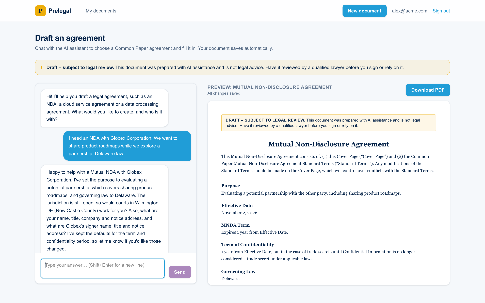
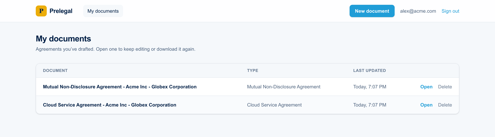
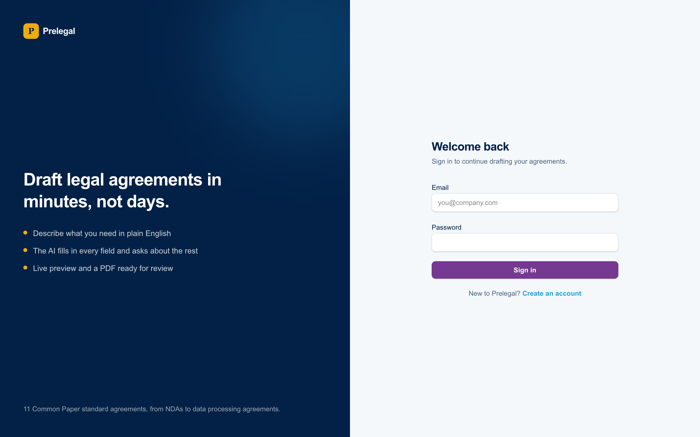

# Prelegal

Prelegal drafts common business agreements through a chat. You describe what you need ("an NDA with Globex so we can talk about a partnership, Delaware law"), the assistant works out which agreement fits, asks for whatever is still missing, and fills in the document as you go. A live preview sits next to the chat, and the finished agreement downloads as a PDF.

The agreements come from [Common Paper](https://commonpaper.com)'s standard templates, which are free to use under CC BY 4.0. Prelegal fills in the cover page; the standard terms themselves are never changed.

Everything Prelegal produces is a draft. The app says so on the drafting page and at the top of every preview and PDF, and the documents should be reviewed by a lawyer before anyone signs them.



## What it does

- **Sign up and sign in.** Accounts use email and password. Passwords are hashed with scrypt, and sessions are kept in an HttpOnly cookie.
- **Draft through a chat.** The assistant (Claude Haiku) picks the document type, fills in the fields you mention, and asks about the rest one or two at a time. If you ask for something it can't draft, such as an employment contract, it says so and suggests the closest agreement it does support.
- **Live preview and PDF.** The preview updates after every reply and shows unfilled fields as placeholders. The PDF is generated in the browser.
- **Saved documents.** Each document saves automatically along with its conversation. The My documents page lists them, and opening one brings back both the draft and the chat so you can carry on where you left off.

Supported agreements: Mutual NDA, Cloud Service Agreement, AI Addendum, Business Associate Agreement, Design Partner Agreement, Data Processing Agreement, Partnership Agreement, Pilot Agreement, Professional Services Agreement, Service Level Agreement and Software License Agreement.





## Running it

You need Docker and an Anthropic API key. Put the key in a `.env` file in the project root:

```
ANTHROPIC_API_KEY=sk-ant-...
```

Then start the app with the script for your OS:

| OS | Start | Stop |
|---|---|---|
| macOS | `scripts/start-mac.sh` | `scripts/stop-mac.sh` |
| Linux | `scripts/start-linux.sh` | `scripts/stop-linux.sh` |
| Windows | `scripts\start-windows.ps1` | `scripts\stop-windows.ps1` |

Open http://localhost:8000 and create an account. The `.env` file is passed to the container at runtime and is never copied into the image. Without a key the app still starts, but the chat returns an error.

The database is SQLite and is recreated every time the container starts, so accounts and documents don't survive a restart. That was a deliberate scope decision for this version.

## How it's built

The whole app ships as one Docker container. A FastAPI backend serves the JSON API under `/api` and the statically exported Next.js frontend at `/`, so there is a single origin and no CORS setup.

| Part | Stack |
|---|---|
| Backend | Python 3.13, FastAPI, Pydantic, SQLite, uv |
| AI | Anthropic Python SDK, Claude Haiku with Structured Outputs |
| Frontend | Next.js 16 (static export), React 19, TypeScript, Tailwind CSS 4 |
| PDF | `@react-pdf/renderer`, run in the browser |
| Tests | pytest with FastAPI's TestClient, Vitest with Testing Library |

A few decisions worth explaining:

**One spec file drives every document.** `documents.json` lists each agreement with its two party roles (Provider and Customer, Company and Partner, and so on) and its cover page fields, each with a label, a description and an optional default. The backend reads it to build the AI prompts and validate drafts. The frontend bundles the same file, along with the template Markdown, to render previews and PDFs. Adding a document is mostly a matter of adding an entry.

**The AI's output schema is built per document.** Each turn, the backend generates a Pydantic model with exactly the current document's fields, each carrying its own description, and asks for a structured response in that shape. Before a document is chosen, the schema only asks for a reply and a document type. When the type changes, the backend starts the new draft (keeping the parties and any fields both documents share) and asks again with the new schema in the same request, so the reply can already fill in what the user said.

**The chat API is stateless.** The client sends the conversation and the current draft on every turn, and the server returns the reply and an updated draft. Model output that doesn't fit, such as a malformed date or an overly long field, falls back to the previous value instead of failing the turn.

**One generic renderer for all the templates.** Common Paper's templates are Markdown with nested numbered clauses and inline spans that mark the variables. A small parser turns them into numbered clauses, and the same structure feeds both the HTML preview and the PDF.

**Saving is separate from chatting.** After each reply the frontend saves the document through a small REST API (create once, then update). Saves are queued so they can't overlap, and a reply that arrives after you've switched to another document is ignored.

## Project layout

```
backend/
  app/
    main.py        app setup and routers
    auth.py        sign-up, sign-in and sessions
    chat.py        prompts, per-document schemas and the chat endpoint
    library.py     saved documents API
    documents.py   loads documents.json
    db.py          SQLite schema
  tests/
frontend/
  app/             pages: sign-in, sign-up, My documents, draft, 404
  components/      auth, layout, document creator, preview and PDF
  lib/             API client, session, template parser, document helpers
docs/screenshots/  images used in this README
templates/         Common Paper agreement templates
documents.json     document specs shared by the backend and frontend
scripts/           start and stop scripts
```

## Development

```bash
# Backend, on http://localhost:8000
cd backend
uv sync
uv run pytest
uv run uvicorn app.main:app --reload

# Frontend, with hot reload on http://localhost:3000
cd frontend
npm ci
npm test
npm run dev
```

The Next.js dev server doesn't proxy `/api`, so the chat only works when the backend serves the frontend. To run the production setup without Docker, build the frontend with `npm run build` (it writes `frontend/out`) and start the backend with `PRELEGAL_STATIC_DIR=../frontend/out`.

After editing `documents.json` or a template, run `npm run sync-templates` in `frontend/` to re-bundle them. A test fails if the bundled copy drifts from the source files.

| Variable | Default | Purpose |
|---|---|---|
| `ANTHROPIC_API_KEY` | unset | Key for the chat; read from `.env` in local development |
| `PRELEGAL_DB_PATH` | `data/prelegal.db` | SQLite file, recreated on startup |
| `PRELEGAL_STATIC_DIR` | unset (API only) | Exported frontend to serve at `/` |
| `PRELEGAL_DOCUMENTS_PATH` | `documents.json` in the project root | Document specs |

## Limitations

- The database resets on every restart.
- There is no password reset or rate limiting.
- The session cookie isn't marked `Secure`, because the app is served over plain HTTP on localhost. It would need to be before deploying behind HTTPS.
- The cover page fields for each agreement were chosen from the template's variables. They haven't been reviewed by a lawyer.

## License

The code is MIT licensed (see `LICENSE`). The agreement templates in `templates/` are by Common Paper and licensed under CC BY 4.0 (see `templates/LICENSE.txt`).
